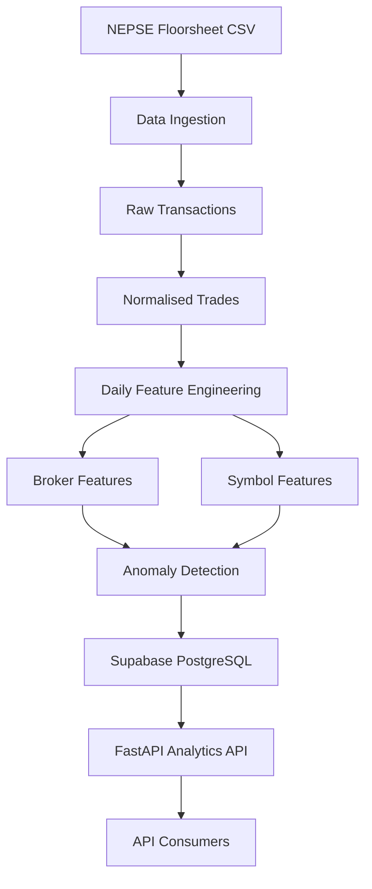

# FloorIQ Nepal

### NEPSE Floorsheet Intelligence API

A Python-based data engineering and analytics system for processing NEPSE floorsheet transactions, generating broker-level and symbol-level features, and identifying unusual trading activity.

FloorIQ Nepal combines **Python, FastAPI, Supabase PostgreSQL, scheduled data pipelines, and anomaly detection** to transform raw floorsheet records into structured analytics accessible through REST APIs.

The project explores how financial market transaction data can be collected, processed, analysed, and delivered through a modular backend architecture.

> **Project Focus:** Data Engineering · Backend Development · Financial Data Analytics

> **Scope:** Descriptive analytics and anomaly detection only. This project does not provide investment recommendations.

---

## Overview

NEPSE floorsheet data contains transaction-level information that can be analysed to understand trading activity across brokers and listed symbols.

FloorIQ Nepal implements a data-processing workflow that:

1. Acquires floorsheet transaction data.
2. Stores raw records and normalised trades.
3. Computes daily broker and symbol features.
4. Identifies unusual activity using anomaly detection.
5. Stores analytical results in PostgreSQL.
6. Exposes insights through FastAPI endpoints.

The system separates data acquisition, processing, analytics, and API delivery into independent components.

---

## System Architecture



The daily refresh process coordinates the data pipeline, while the FastAPI application serves analytics from the database.

An optional Redis layer can provide caching when configured.

---

## Core Capabilities

### 1. Floorsheet Data Ingestion

The ingestion workflow handles floorsheet CSV data and prepares it for analytical processing.

It separates:

- Raw transaction records
- Normalised trade records
- Supporting transaction information

Raw and processed data are stored in PostgreSQL tables for downstream analysis.

### 2. Daily Feature Engineering

The pipeline generates daily analytical features for:

**Broker-Level Analysis**

- Broker-related transaction activity
- Daily features derived from trading records
- Structured broker analytics

**Symbol-Level Analysis**

- Trading activity for listed symbols
- Daily features derived from transaction records
- Structured symbol analytics

The generated features are used by the analytics and anomaly detection stages.

### 3. Anomaly Detection

The system identifies trading activity that differs from expected or typical patterns according to its implemented detection logic.

Anomaly results are stored for analytical inspection.

**An anomaly flag is not evidence of market manipulation, wrongdoing, or a regulatory violation.**

It is an analytical signal that may require additional investigation.

### 4. Analytics API

FastAPI provides endpoints for accessing processed market insights.

The application separates API routing and business logic from data ingestion and feature generation.

### 5. Scheduled Data Refresh

The project supports scheduled and manually triggered refresh workflows using GitHub Actions.

The refresh process coordinates data acquisition, ingestion, feature generation, and anomaly detection.

---

## Technology Stack

| Technology | Responsibility |
| :--- | :--- |
| Python | Data processing and backend development |
| FastAPI | REST API development |
| Supabase PostgreSQL | Persistent data storage |
| Redis | Optional caching |
| GitHub Actions | Scheduled and manual refresh workflows |
| Jupyter Notebook | Exploration and validation |
| Git | Version control |

The API is designed to continue operating without Redis when the optional cache is unavailable.

---

## Data Pipeline

The operational refresh entry point is:

```bash
PYTHONPATH=. python scripts/refresh.py
```

This coordinates the core analytics stages.

### Pipeline Stages

| Stage | Script / Tool | Purpose |
| :--- | :--- | :--- |
| Acquisition | `nepse-cli` | Retrieve floorsheet CSV data |
| Ingestion | `ingest_floorsheet.py` | Load raw and normalised transactions |
| Feature Engineering | `build_daily_features.py` | Compute broker and symbol features |
| Anomaly Detection | `detect_anomalies.py` | Identify unusual activity |
| API Delivery | FastAPI | Serve stored analytics |

### Manual Data Acquisition

```bash
nepse-cli --get-floorsheet --to-csv --output-file data/raw/floorsheet_latest.csv
```

The acquisition command requires `nepse-cli` to be available in the environment.

### Ingest Floorsheet Records

```bash
PYTHONPATH=. python scripts/ingest_floorsheet.py
```

### Generate Daily Features

```bash
PYTHONPATH=. python scripts/build_daily_features.py YYYY-MM-DD
```

Replace `YYYY-MM-DD` with the intended processing date.

### Detect Anomalies

```bash
PYTHONPATH=. python scripts/detect_anomalies.py YYYY-MM-DD
```

### Refresh Using Existing Local Data

When the floorsheet CSV is already available locally:

```bash
PYTHONPATH=. python scripts/refresh.py --skip-fetch
```

This skips the acquisition stage and continues processing the available local input.

---

## API Endpoints

FloorIQ Nepal exposes analytics through FastAPI.

| Method | Endpoint | Description |
| :--- | :--- | :--- |
| GET | `/insights/broker/{id}` | Retrieve analytics for a selected broker |
| GET | `/insights/symbol/{symbol}` | Retrieve analytics for a selected trading symbol |
| GET | `/anomalies/today?limit=50` | Retrieve recent anomaly results with a requested result limit |

### Example Requests

**Broker Insights**

```http
GET /insights/broker/1
```

**Symbol Insights**

```http
GET /insights/symbol/NABIL
```

**Anomaly Results**

```http
GET /anomalies/today?limit=50
```

The examples illustrate endpoint usage rather than guaranteed availability of particular broker or symbol records.

### Analytics Disclaimer

The API includes a disclaimer payload in its responses.

The system provides descriptive insights and anomaly flags. It does not generate buy, sell, or hold recommendations.

---

## Database Architecture

Supabase PostgreSQL is the primary data storage layer.

The current runtime schema is defined in:

```text
supabase/schema.sql
```

### Core Analytics Tables

| Table | Purpose |
| :--- | :--- |
| `raw_floorsheet` | Raw floorsheet transaction records |
| `trades` | Normalised transaction data |
| `broker_daily_features` | Daily broker-level features |
| `symbol_daily_features` | Daily symbol-level features |
| `anomalies` | Detected unusual activity |

### Supporting Runtime Tables

The same schema also includes:

- `brokers_subscription`
- `payment_requests`
- `admin_users`
- `broker_audit_log`
- `model_registry`
- `model_training_runs`

These tables support additional application and operational requirements.

Their presence does not imply that trading recommendations or automated trading features are implemented.

---

## Getting Started

The following setup instructions are based on the project's macOS development workflow.

### Prerequisites

- Python
- pip
- PostgreSQL database hosted through Supabase
- Required credentials
- `nepse-cli` for the floorsheet acquisition step

### 1. Clone the Repository

```bash
git clone https://github.com/GaneshPokharel-tech/flooriq-nepal.git
cd flooriq-nepal
```

### 2. Create a Virtual Environment

```bash
python3 -m venv .venv
source .venv/bin/activate
```

### 3. Install Dependencies

```bash
pip install --upgrade pip
pip install -r requirements.txt
```

### 4. Configure Environment Variables

Create the local environment file:

```bash
cp .env.example .env
```

Update the Supabase connection values:

```env
SUPABASE_DB_HOST=your_database_host
SUPABASE_DB_USER=your_database_user
SUPABASE_DB_PASSWORD=your_database_password
```

Database port, name, and SSL mode have defaults defined in the application configuration.

Never commit actual database credentials or other secrets.

### 5. Initialise the Database

Open the Supabase SQL Editor.

Run:

```text
supabase/schema.sql
```

This creates the current core runtime schema required by the API and refresh pipeline.

### 6. Run the Data Pipeline

```bash
PYTHONPATH=. python scripts/refresh.py
```

To process an existing locally downloaded CSV:

```bash
PYTHONPATH=. python scripts/refresh.py --skip-fetch
```

### 7. Start the API

```bash
uvicorn app.main:app --reload --port 8000
```

The application will start on the configured local port.

With FastAPI's default interactive documentation enabled, API documentation is available at:

```text
http://127.0.0.1:8000/docs
```

---

## Optional Database Bootstrap

An additional reviewed bootstrap workflow is available.

It is **not required for the standard setup**.

### Apply Additional Idempotent Bootstrap

```bash
PYTHONPATH=. python scripts/run_migration.py
```

### Include Secondary Acquisition Provenance Tables

```bash
PYTHONPATH=. python scripts/run_migration.py --include-secondary-acquisition-provenance
```

This optional flag also processes the secondary acquisition provenance SQL definitions.

Review the migration's effect on the target database before running it, particularly when using a database containing existing data.

---

## Repository Structure

```text
flooriq-nepal/
│
├── app/
│   ├── routers/
│   ├── services/
│   └── templates/
│
├── scripts/
│   ├── refresh.py
│   ├── ingest_floorsheet.py
│   ├── build_daily_features.py
│   ├── detect_anomalies.py
│   └── run_migration.py
│
├── notebooks/
│
├── supabase/
│   └── schema.sql
│
├── data/
│   ├── raw/
│   └── normalized/
│
├── requirements.txt
├── .env.example
└── README.md
```

### Directory Responsibilities

| Directory | Responsibility |
| :--- | :--- |
| `app/` | FastAPI routes, services, and application logic |
| `scripts/` | Data acquisition, ingestion, feature engineering, and anomaly detection |
| `notebooks/` | Exploratory analysis and validation |
| `supabase/` | Database schema |
| `data/raw/` | Local source files |
| `data/normalized/` | Local processed files |

The local `data/raw/` and `data/normalized/` working directories are excluded from Git tracking.

---

## Operational Considerations

### Data Reliability

Analytics quality depends on the completeness, consistency, and availability of the upstream floorsheet data.

Missing, delayed, or incorrect records can affect generated features and anomaly results.

### Database Configuration

The application requires valid database connection settings for ingestion, analytics storage, and API operations.

### Optional Caching

Redis is optional.

The application is designed to continue functioning when Redis is not configured or available.

### Scheduled Jobs

GitHub Actions supports scheduled and manual refresh operations.

Database credentials used by automated workflows must be configured securely and should not be stored directly in workflow files.

---

## Limitations

- The system provides descriptive analytics rather than investment predictions.
- Anomaly flags are analytical indicators, not findings of misconduct.
- Results depend on the quality and availability of floorsheet source data.
- The data acquisition workflow depends on external tooling and data availability.
- The project does not provide buy, sell, or hold recommendations.
- An analytics API should not be exposed publicly without reviewing authentication, authorization, database permissions, rate limiting, and operational security.
- The project documentation does not establish regulatory approval or compliance certification.

---

## Disclaimer

FloorIQ Nepal is an independent software engineering and market-data analytics project.

It is intended for educational, research, and descriptive analytics purposes.

The application:

- Does not provide investment advice.
- Does not make buy, sell, or hold recommendations.
- Does not guarantee the accuracy or completeness of market data.
- Does not establish that flagged activity constitutes market manipulation or a legal violation.
- Does not imply endorsement or approval by NEPSE, SEBON, or any other regulatory authority.

Users should independently verify market information before relying on it for financial or business decisions.

---

## Author

**Ganesh Pokharel**

AI Engineer | Python Developer

[GitHub](https://github.com/GaneshPokharel-tech) · [LinkedIn](https://www.linkedin.com/in/ganesh-pokharel-30786b192/)

---

*An applied Python and data engineering project focused on NEPSE floorsheet processing, analytics pipelines, anomaly detection, and API development.*
